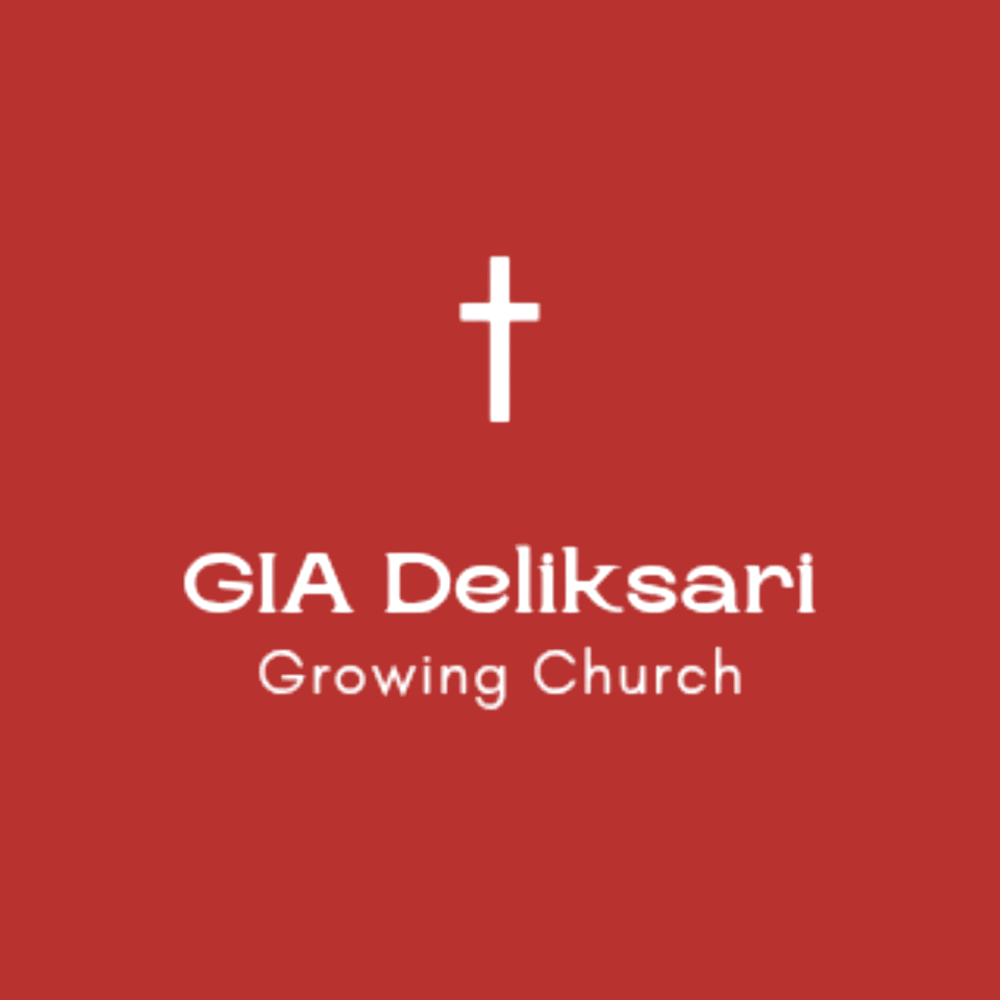

<div align="center">

  

  # GIA DELIKSARI SEMARANG
  ### Portal Publik Jemaat & Sistem Informasi Operasional Gereja
  
  [](https://nextjs.org/)
  [](https://react.dev/)
  [](https://www.typescriptlang.org/)
  [](https://tailwindcss.com/)
  [](https://developers.cloudflare.com/d1/)
  [](LICENSE)

  <p align="center">
    <strong>Gereja Isa Almasih Deliksari</strong> — <em>"A Growing Church in Faith, Love, and Hope"</em><br />
    Jl. Kolonel Hadijanto, Deliksari, Gunung Pati, Kota Semarang, Jawa Tengah 50229
  </p>

</div>

---

## 🌐 Halaman & Akses Aplikasi (Live Deployment)

Website telah resmi aktif dan ter-deploy secara langsung di **Cloudflare Workers (OpenNext)**:
**[giadeliksari.my.id](https://giadeliksari.my.id)** *(Edge Worker: [gia-deliksari-web.zzdree.workers.dev](https://gia-deliksari-web.zzdree.workers.dev))*

| Portal | Path | Akses | Deskripsi singkat |
|---|---|---|---|
| 🕊️ **Beranda Jemaat** | [`/home`](/home) | publik | Landing page: profil gereja, warta, jadwal, galeri, kontak, persembahan. |
| 📋 **Info Pelayanan** | [`/info`](/info) | publik | Papan warta + jadwal pelayanan fokus operasional. |
| 🛡️ **Admin / Operator** | [`/admin`](/admin) | `super` / `admin` | 5 tab: Warta, Roster, Layanan Jemaat, Khotbah & Galeri, Inventaris. |
| 👑 **Superuser** | [`/super`](/super) | `super` only | User management (create, edit roles, soft-delete). |
| 💰 **Kas Youth** | [`/kas`](/kas) | `super` / `treasurer` | Catat pemasukan/pengeluaran kas Grow Generation + saldo realtime. |

Akun production saat ini (lihat INFO.md §10.2 untuk detail):
- `andreas` / `5050` → `super` (akses semua portal)
- `zzdree` / `9090` → `admin` + `treasurer` (akses `/admin` & `/kas`)

---

## 📖 Ringkasan Proyek

**GIA Deliksari Web** adalah platform digital komprehensif yang dibangun khusus untuk melayani jemaat **Gereja Isa Almasih (GIA) Deliksari Semarang**. Platform ini menggabungkan landing page publik yang modern, responsif, dan interaktif dengan portal manajemen operasional gereja yang terintegrasi langsung ke cloud database **Supabase**.

### 🌟 Fitur Utama

### 1. Public Landing Page (`/public` & `/`)
- **Hero & Church Identity**: Banner foto riil gedung gereja, tagar *"GROWING CHURCH! 🔥"*, serta akses cepat ke warta dan jadwal.
- **Tentang & Gembala Sidang**: Profil pelayanan **Ps. Yohanes Sutono** beserta visi, misi, dan nilai-nilai inti jemaat.
- **4 Pilar Pelayanan Ibadah**:
  1. ⛪ **Ibadah Raya Umum** (Minggu 07:00 & 16:30 WIB)
  2. 🔥 **Grow Generation Youth / PRBK** (Sabtu 17:00 WIB)
  3. 🎨 **COC Kidz / Sekolah Minggu** (Minggu 07:00 WIB)
  4. 🌸 **Persekutuan Kaum Wanita Hana** (Kamis 16:00 WIB)
- **Papan Warta & Pengumuman Interaktif**: Menampilkan pengumuman minggu depan/bulan ini yang terfilter langsung dari database.
- **Galeri Dokumentasi Foto Asli**: 8+ foto resolusi tinggi terverifikasi dari Google Maps dan YouTube dengan filter kategori dan tampilan *interactive lightbox modal*.
- **Lokasi & Google Maps**: Integrasi lokasi resmi, panduan rute navigasi, dan tautan deep link WhatsApp doa/konseling.
- **Dark Mode & Light Mode**: Dukungan pergantian tema dinamis (*persisted*).

### 2. Admin Operational Portal (`/admin`)
- 🔒 **Security Gate**: Terproteksi password session-based (`1515`).
- 📢 **Manajemen Warta & Pengumuman**: Tambah, edit, hapus, pin warta prioritas, dan filter status publikasi.
- 👥 **Plotting Jadwal Pelayan Ibadah**: Tab khusus untuk 4 kategori (General, Youth, Kidz, Hana) dengan input peran (WL, Singer, Pemusik, Multimedia, Usher, dll), nomor telepon, dan status konfirmasi.
- 📦 **Checklist & Audit Inventaris**: Daftar inventaris alat gereja (Sound System, Multimedia, Musik, Kursi & Gedung) dengan fitur centang/uncentang realtime, filter status kondisi (*Good / Maintenance / Broken*), dan reset checklist sebelum ibadah.
- 🔄 **Supabase Dual-Sync Engine**: Otomatis menyimpan data ke cloud database Supabase PostgreSQL sekaligus caching lokal di `localStorage` saat offline.

---

## 🛠️ Tech Stack & Arsitektur

```mermaid
graph TD
    Client[Browser Desktop / Mobile] --> NextApp[Next.js 16.3.3 App Router]
    NextApp --> PublicHome["Public (/home, /info)"]
    NextApp --> AdminPortal["/admin (super | admin)"]
    NextApp --> SuperPortal["/super (super only)"]
    NextApp --> KasPortal["/kas (super | treasurer)"]
    PublicHome --> APIs[/api/public/*]
    AdminPortal --> APIs
    SuperPortal --> APIs
    KasPortal --> APIs
    APIs --> AuthLib["src/lib/auth.ts (multi-role + bcrypt + rate-limit)"]
    AuthLib --> D1Admin[(Cloudflare D1 SQLite - gia-deliksari-db)]
    AdminPortal --> Drive[Google Drive + Service Account / OAuth]
    PublicHome --> YouTube[YouTube Data API v3]
    D1Admin --> Sheets[Google Sheets Sync via GitHub Actions]
```

- **Framework**: Next.js 16.3.3 (App Router, Server Components & Static Site Generation)
- **Runtime**: Cloudflare Workers via OpenNext (`@opennextjs/cloudflare`)
- **UI & Styling**: React 19, Tailwind CSS 3 (Warm Alabaster & Sacred Wine palette + Impeccable design system, Dark/Light mode)
- **Database**: Cloudflare D1 (Serverless SQLite Edge) 9 tables + 1 view (24/7 Always Active)
- **Auth**: bcrypt (cost 10) + HMAC-SHA256 signed session cookie + rate limit
- **Storage**: Google Drive master archive + Cloudflare edge delivery
- **Integrations**: YouTube Data API v3 (khotbah auto-sync), Google Sheets (transparansi pengurus)
- **Icons & Assets**: Lucide React Icons & Custom Church Brand SVG Icons
- **Optimization**: `next/image` modern AVIF/WebP image pipeline, edge caching via Cloudflare CDN

---

## 📁 Struktur Direktori

```text
gia-deliksari-web/
├── public/
│   └── images/                 # Aset foto asli resolusi tinggi & logo gereja
│       ├── logo.png            # Logo resmi GIA Deliksari
│       ├── hero-church.jpg     # Foto tampak depan gedung fisik gereja
│       ├── pastor-yohanes.jpg  # Ps. Yohanes Sutono di mimbar
│       ├── ministry-*.jpg      # Foto dokumentasi 4 pilar pelayanan
│       └── gallery-*.jpg       # Galeri foto kegiatan & persekutuan
├── src/
│   ├── app/
│   │   ├── layout.tsx          # Root layout & tema
│   │   ├── page.tsx            # Redirect '/' → '/home'
│   │   ├── home/page.tsx       # Landing publik jemaat (8+ section)
│   │   ├── info/page.tsx       # Halaman fokus warta + jadwal pelayanan
│   │   ├── admin/page.tsx      # Portal admin (5 tab CRUD)
│   │   ├── super/page.tsx      # Portal superuser (user management)
│   │   ├── kas/page.tsx        # Portal kas youth (treasury)
│   │   ├── manifest.ts         # PWA manifest
│   │   ├── robots.ts           # SEO robots
│   │   ├── sitemap.ts          # SEO sitemap
│   │   └── api/
│   │       ├── auth/           # login / logout / check (multi-role + bcrypt)
│   │       ├── users/          # CRUD user (super only)
│   │       ├── admin/data/     # CRUD warta/roster/inventaris/khotbah/galeri
│   │       ├── public/data/    # Read publik sanitasi
│   │       ├── public/ministry-requests/  # Submit permohonan jemaat
│   │       ├── gallery/        # upload + sync ke Google Drive
│   │       ├── youtube/latest/ # Fetch khotbah terbaru YouTube Data API v3
│   │       ├── youth-treasury/ # CRUD transaksi kas
│   │       └── debug/env/      # Diagnostic env vars (admin-only)
│   ├── components/             # Section publik + admin hooks
│   │   ├── Hero.tsx, Navbar.tsx, Footer.tsx, ThemeToggle.tsx, …
│   │   └── admin/              # useAdminAuth, useAdminData, useToast
│   ├── lib/
│   │   ├── auth.ts             # Multi-role auth + bcrypt + rate limit
│   │   ├── d1.ts               # Cloudflare D1 unified client (edge/dev/test)
│   │   ├── googleDrive.ts      # Drive OAuth + folder router
│   │   ├── scheduleUtils.ts    # 4-week rotating schedule helpers
│   │   └── seedData.ts         # Initial placeholder per table
│   └── types/index.ts          # TypeScript interfaces
├── migrations/                 # Cloudflare D1 SQL migrations
│   ├── 0001_initial_schema.sql # 9 tables + 1 view D1 schema
│   └── 0002_initial_seed.sql   # Initial seed data
├── scripts/                    # Ops tooling (D1 backup to sheets, drive diagnostic)
├── .github/workflows/
│   ├── backup-d1-to-sheets.yml # GH Actions daily D1 → Google Sheets
│   └── ci.yml                  # TypeScript + Vitest + Playwright CI
├── backups/                    # Auto-generated SQL / JSON snapshots
├── INFO.md                     # Single source of truth (identitas, jadwal, struktur)
├── PRD.md                      # Product Requirements Document
├── DESIGN.md                   # Design System & Token Specification v3.4.0
├── LICENSE                     # Proprietary & Private
└── package.json
```

---

## 🗄️ Skema Database Cloudflare D1

Proyek ini menggunakan 9 tabel + 1 view di Cloudflare D1 Serverless SQLite (lihat `migrations/`):

| Tabel / View | Fungsi |
|---|---|
| `announcements` | Warta jemaat + tanggal acara + pin + status publikasi. |
| `servant_rosters` | Plotting pelayan ibadah 4 komunitas + peran + WhatsApp. |
| `inventory_items` | Inventaris alat gereja + checklist + kondisi. |
| `sermons` | Khotbah + YouTube sync metadata. |
| `gallery_items` | Foto galeri hybrid (Drive master + D1 cache). |
| `ministry_requests` | Permohonan jemaat (doa, baptisan, komsel, volunteer). |
| `users` | Multi-role auth (super / admin / treasurer) + bcrypt hash. |
| `youth_treasury_transactions` | Buku kas Grow Generation (income/expense). |
| `youth_treasury_balance` (view) | Agregat saldo realtime (income, expense, balance, counts). |

Keamanan: Hanya published rows yang bisa diakses publik via API sanitized. Mutasi diproteksi autentikasi `requireRole(['super', 'admin', 'treasurer'])`.

---

## 🚀 Panduan Menjalankan Proyek Secara Lokal

### 1. Clone Repository & Masuk Direktori
```bash
git clone https://github.com/zzdree/gia-deliksari-web.git
cd gia-deliksari-web
```

### 2. Install Dependensi
```bash
npm install
```

### 3. Konfigurasi Environment Variables
Buat file `.env.local` dan `.dev.vars` di root proyek (lihat `.env.example` untuk dokumentasi lengkap):
```env
# URL Site
NEXT_PUBLIC_SITE_URL=http://localhost:3000

# Admin / Auth
ADMIN_SESSION_SECRET=<random-32-char-string>

# Google Drive (OAuth)
GOOGLE_OAUTH_CLIENT_ID=
GOOGLE_OAUTH_CLIENT_SECRET=
GOOGLE_OAUTH_REFRESH_TOKEN=
GOOGLE_DRIVE_PUBLIC_FOLDER_ID=

# YouTube Data API v3
YOUTUBE_API_KEY=
YOUTUBE_CHANNEL_ID=UCDh3ojx9ne3HOPoBuuoKlrg
```

### 4. Setup Database D1 Lokal
```bash
# Migrasi skema lokal D1
npm run d1:migrate:local

# Seed data awal lokal
npm run d1:seed:local
```

### 5. Jalankan Development Server
```bash
npm run dev
```
Buka browser di [http://localhost:3000](http://localhost:3000) — otomatis redirect ke `/home`.

### 6. Build untuk Produksi
```bash
npm run build
npm run start
```

---

## 📱 Media Sosial & Kontak Resmi Gereja

- 📷 **Instagram**: [@giadeliksari](https://www.instagram.com/giadeliksari/)
- 🔥 **Youth Instagram**: [@growgeneration_](https://www.instagram.com/growgeneration_/)
- 🎈 **Kids Instagram**: [@cockidz](https://www.instagram.com/cockidz/)
- 🎥 **YouTube Channel**: [@GIADeliksariSemarang](https://www.youtube.com/@GIADeliksariSemarang)
- 📍 **Google Maps**: [Gereja Isa Almasih Deliksari Semarang](https://share.google/O7HqL1J615kgxt66v)

---

## 🔒 Lisensi

Kode sumber dan seluruh aset dalam proyek ini bersifat **Proprietary & Private (All Rights Reserved)**. Hak Cipta dilindungi undang-undang atas nama **Gereja Isa Almasih Deliksari Semarang**. Detail ketentuan tertera pada file [LICENSE](LICENSE).
